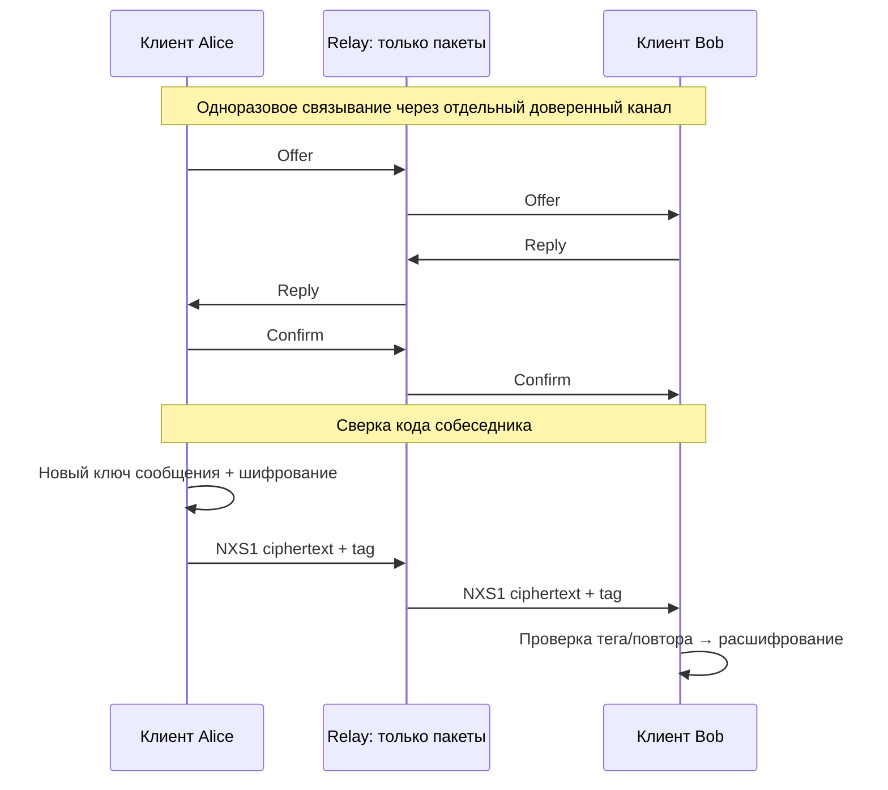

# NAXi / NA&STY-X — работающий E2EE-прототип

Этот отчёт сформирован из выполненного трёхпроцессного сценария. Все тексты демонстрационные; это проверка поведения, не доказательство стойкости.



## Трасса выполненного сценария

| Событие | Результат |
|---|---|
| ПРОЦЕССЫ | Сервер 3424; Alice 12184; Bob 5072 |
| СВЯЗЫВАНИЕ | Коды совпали: 32b8c212e2858b81959c6738b20c62e0; сеанс a00f9746d2ef5e339916b40cd3f12848 |
| СООБЩЕНИЕ | alice → bob: Привет, Bob! Сервер не получает этот текст. |
| СЕРВЕР | 186 байт; шифротекст: 810de413231b7004ac722459d2e9ee7d9b01274976fa10bac84f94a55eede9d5aeae51ee243cb771… |
| СООБЩЕНИЕ | bob → alice: Привет, Alice! Сообщение расшифровано на моей стороне. |
| СЕРВЕР | 206 байт; шифротекст: 630919df1d717ec09a2665af079a7fecdae539a50b0d9c8b150f7053e42ef1978b59157949bf8b04… |
| ПОВТОР | Отклонено; открытый текст не выдан |
| ПОДМЕНА | Отклонено; открытый текст не выдан |
| ПОСЛЕ ПОДМЕНЫ | Проверка целостности |
| ПЕРЕСТАНОВКА | Пришёл 2: Порядок 2 |
| ПЕРЕСТАНОВКА | Пришёл 0: Порядок 0 |
| ПЕРЕСТАНОВКА | Пришёл 1: Порядок 1 |
| СВЯЗЫВАНИЕ | Коды совпали: 1084ac0e72e9a9266825797489088ace; сеанс c55c129dbb5b1ce66be23af0e1bf0940 |
| СТАРЫЙ СЕАНС | Отклонено; открытый текст не выдан |
| СООБЩЕНИЕ | alice → bob: Новый сеанс после повторного связывания. |
| СЕРВЕР | 187 байт; шифротекст: 72878682940b72e7db649edd3592560a8314abefdf53f2b9c02bf44a911b368345e0e935a922ee5d… |
| ПОСЛЕ СБОЯ БЕЗ КЛЮЧЕЙ | Отклонено; открытый текст не выдан |
| ПЕРЕЗАПУСК | Новый процесс Bob 19336; требуется новое связывание |
| СВЯЗЫВАНИЕ | Коды совпали: 4784c2f230b2b48891a8ce93d8c4eafe; сеанс e1af1b37d0654d0d0036376626bfbdbd |
| ПАКЕТ ДО СБОЯ | Отклонено; открытый текст не выдан |
| СООБЩЕНИЕ | alice → bob: Связь восстановлена новым сеансом после сбоя. |
| СЕРВЕР | 196 байт; шифротекст: 518d0e4bbda0ec3dcab052a1971d1da7763279cb593ccf917155166afcfaaba6a21c6faed4890b66… |
| ИТОГ | Доставка, ответы, повторы, подмена, перестановка, обновление и перезапуск проверены |
| СООБЩЕНИЕ | alice → bob: Проверка |
| СЕРВЕР | 128 байт; шифротекст: 36034622353f4f808ead74e943a90c5b… |
| СООБЩЕНИЕ | bob → alice: Ответ |
| СЕРВЕР | 122 байт; шифротекст: 1f7205332e6dc69e63ba… |
| ПОВТОР | Отклонено; открытый текст не выдан |
| ПОДМЕНА | Отклонено; открытый текст не выдан |
| ПЕРЕСТАНОВКА | Пришёл 2: Порядок 2 |
| ПЕРЕСТАНОВКА | Пришёл 0: Порядок 0 |
| ПЕРЕСТАНОВКА | Пришёл 1: Порядок 1 |
| СВЯЗЫВАНИЕ | Коды совпали: 71f2ac0d192f372a5c0c70a39589ba10; сеанс 8a9dfad1f8d7be0f50ab6290521967e6 |
| ПОСЛЕ СБОЯ БЕЗ КЛЮЧЕЙ | Отклонено; открытый текст не выдан |
| ПЕРЕЗАПУСК | Новый процесс Bob 26384; требуется новое связывание |
| СВЯЗЫВАНИЕ | Коды совпали: 456ffe8726f6a2cdf8317afac4e7c2eb; сеанс bf75c24569aa5799724b7f30120d5861 |
| ПАКЕТ ДО СБОЯ | Отклонено; открытый текст не выдан |
| СООБЩЕНИЕ | alice → bob: Связь восстановлена новым сеансом после сбоя. |
| СЕРВЕР | 196 байт; шифротекст: f4f9ae0870572553a438188cc7813df165aa9427eb9c75f441a3fdc6d0a778e7ca45f91ae6f3600b… |
| СЕРВЕР | 38 публичных пакетов; URL http://127.0.0.1:4773 |

## Что видел сервер

В журнале relay **38 пакетов**. Каждая запись содержит только `to`, `packet` (hex) и `bytes`. Открытые тексты таблицы выше получены от клиентов доверенным локальным пультом, не из журнала relay.

Пример полной первой зашифрованной записи:

```text
4e58533100000000a00f9746d2ef5e339916b40cd3f1284868384e02aa596f2e0e1df3dc1e115544ee627d6f41fe4d5384640e68ed0cbbc30000000000000000000000764e584d3303010000000000000000000000000000000000440000004a810de413231b7004ac722459d2e9ee7d9b01274976fa10bac84f94a55eede9d5aeae51ee243cb771edf93efec1741fad09b8fcafd3ec124690ffce4bc8df7108bb2623f0190c5e14b2d812061b9dc7c9b1b1d46d60649cb0f2d2
```

## Запуск

Из C:\Crypto:

```powershell
py -3 demos/e2ee_chat.py --interactive
```

После автоматического сценария вводи `alice текст` или `bob текст`. Команды `replay`, `tamper`, `reorder`, `renew`, `restart`, `status`, `quit` проверяют повторы, подмену, перестановку, новое связывание и сбой.

Для повторного сохранения отчёта:

```powershell
py -3 demos/e2ee_chat.py --report research/results/e2ee-demo-v1.json
py -3 research/summarize_e2ee_demo.py
```

## Ограничения применения

Это готовый прототип для экспериментов и интеграции с тестовыми данными. **Реальную переписку защищать этой версией нельзя считать безопасным.** Нет независимого криптоанализа, гарантированного удаления/хранения ключей, асимметричного согласования или автоматической PCS. Первое связывание и восстановление требуют внешнего доверенного канала; после перезапуска история/ключи не восстанавливаются. Демо на одном компьютере не защищает от администратора/вредоносного ПО этой ОС.

Точная спецификация: [SESSION_SPEC_V1.md](SESSION_SPEC_V1.md). Внешняя оценка: [REVIEW_REQUEST.md](REVIEW_REQUEST.md) (подготовлена, не выполнена).
